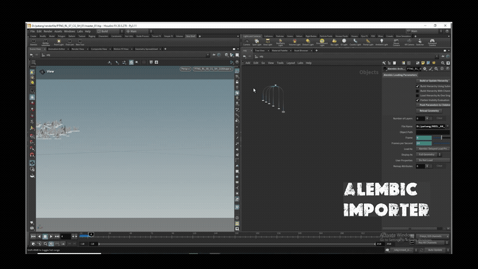

# Simple Batch Alembic Importer

A lightweight Python / PySide2 tool for **SideFX Houdini** to batch import and organize multiple Alembic (`.abc`) cache files in one go.



*(Full 1080p recording available in the repo: [Alembic importer.mp4](Alembic%20importer.mp4))*

---

## Why I Built This

Built while freelancing for an animation & VFX studio in Hyderabad. Artists had shots with dozens of Alembic caches per scene, and importing them one by one, filtering out intermediate passes (`_sim`, `_vel`, `_proxy`), and building subnets manually was eating up hours. This tool automates the entire ingestion in a few clicks.

---

## Features

- **Drag & Drop:** Drop any cache folder directly into the tool.
- **Recursive Scan:** Finds all `.abc` files across nested subdirectories.
- **Wildcard & Exclude Filters:** Target specific assets (`*hero*`) and skip unwanted passes (`_sim, _vel, _proxy`).
- **Node Name Sanitization:** Converts filenames into valid Houdini node names (handles illegal characters and numbers).
- **Archive & ROP Modes:** Supports standard `alembicarchive` geometry nodes and `rop_alembic` output nodes.
- **Subnet Organization:** Packages each import into its own subnet and auto-arranges the network layout.
- **SCENE Null Hookup:** Automatically connects imported nodes to an `/obj/SCENE` null.
- **Duplicate & Reload Handling:** Skip duplicates or reload existing nodes with updated cache paths.
- **Dry Run Mode:** Preview what will be imported or skipped in the log before modifying your scene.
- **File Details:** View file size and last modified date for any selected cache.

---

## Installation & Running in Houdini

You don't need any complex installation. Just run the script inside Houdini.

### Option 1: Add it as a Shelf Tool (Recommended)

1. Right-click on any shelf in Houdini and choose **New Tool...**
2. Name it `batch_alembic_importer` and set the label to `Alembic Importer`.
3. Under the **Script** tab, set the language to **Python** and add:

```python
import sys

# Update this path to where you cloned or saved the folder
tool_dir = r"D:/Alembic Importer"

if tool_dir not in sys.path:
    sys.path.append(tool_dir)

import Alembic_importer
Alembic_importer.show_alembic_import_tool()
```

4. Hit **Apply** and click the new shelf button to open the window.

### Option 2: Python Source Editor / Python Shell

You can also paste the contents of `Alembic_importer.py` into Houdini's **Python Source Editor** (**Windows > Python Source Editor**) or run it directly from the **Python Shell**:

```python
exec(open(r"D:/Alembic Importer/Alembic_importer.py").read())
```

---

## Typical Workflow

1. Paste or drag your cache folder into the **Base Folder** field.
2. (Optional) Adjust your **File Pattern** and **Exclude Keywords** if you only want specific assets.
3. Click **Scan Folder**.
4. Check or uncheck files from the list as needed.
5. Choose your options:
   - Keep **Group in Subnets** checked if you want each asset inside a subnet.
   - Turn on **Dry Run** if you want to inspect the log before modifying your scene.
6. Click **Import**.

---

## Requirements

- **SideFX Houdini:** Tested on Houdini 18.5, 19.x, and 20.x
- **Python:** Python 3 (standard with modern Houdini installs)
- **GUI:** PySide2 (comes built-in with Houdini)
- **OS:** Windows, Linux, macOS

---

## License

MIT License. Feel free to modify and use it in your own personal or studio pipelines.
