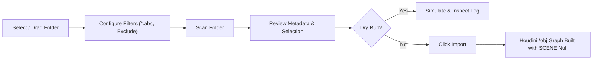

# Simple Batch Alembic Importer for SideFX Houdini

[](https://www.sidefx.com/)
[](https://www.python.org/)
[](LICENSE)
[]()

> A robust, artist-friendly PySide2 batch ingestion tool designed to automate and streamline the import of multiple Alembic (`.abc`) cache files into SideFX Houdini.

---

## 🎬 Demo

<div align="center">
  
  <p align="center">
    <em>⚡ Demo autoplays above. For the full 1080p HD video walkthrough, check <a href="Alembic%20importer.mp4"><strong>Alembic importer.mp4</strong></a>.</em>
  </p>
</div>

---

## 📖 Origin & Background

This tool was originally developed during a freelance technical direction project for a VFX and 3D animation studio based in **Hyderabad, India**. 

### The Problem
During production shot setups, artists received heavy shots containing dozens of separate Alembic caches—characters, background assets, FX debris, and dynamic cloth simulations. Manually importing each Alembic file, configuring parameters, organizing subnets, naming nodes according to studio conventions, and wiring them into scene nulls was repetitive, prone to human error, and cost artists hours of turnaround time.

Furthermore, cache directories frequently contained intermediate files (such as velocity passes `_vel`, simulation caches `_sim`, or proxy geo `_proxy`) that needed to be excluded from lighting and layout scenes, while main asset files followed specific naming rules requiring sanitization to be valid Houdini node identifiers.

### The Solution
**Simple Batch Alembic Importer** provides a single, unified interface that scans directories recursively, filters files by pattern and exclusion keywords, sanitizes node names to comply with both studio naming standards and Houdini syntax rules, organizes them into subnets with automatic network layouts, and hooks them up to the `/obj/SCENE` pipeline hierarchy.

---

## ✨ Key Features

- **📂 Drag & Drop Folder Selection:** Drag directory paths directly from your operating system file browser into the tool, or use the native folder browser.
- **🔍 Recursive Folder Scanning:** Detects all `.abc` files across nested subdirectories in one scan.
- **🎯 Smart Filtering & Exclusion:**
  - **Pattern Matching:** Filter files using wildcard expressions (e.g., `*hero*.abc`, `shot_010_*.abc`).
  - **Exclusion Keywords:** Comma-separated exclude list (default: `_sim, _vel, _proxy`) to avoid cluttering scenes with unwanted intermediate caches.
- **🏷️ Studio Naming Convention Sanitization:**
  - Cleans filenames into valid Houdini node names (replaces invalid characters with underscores).
  - Automatically prepends an underscore if a filename starts with a number.
- **📦 Dual Node Type Support:**
  - **Alembic Archive (`alembicarchive`):** Standard geometry import for layout, lighting, and rendering.
  - **ROP Alembic (`rop_alembic`):** For caching, retiming, and pipeline export setups.
- **🗂️ Clean Subnet Organization:**
  - Automatically wraps each imported Alembic inside an individual subnet container (`<name>_subnet`).
  - Cleans up node layout inside the subnet (`layoutChildren()`).
  - Connects nodes or subnets directly into a central `/obj/SCENE` null node.
- **🔄 Intelligent Duplicate Handling:**
  - **Avoid Duplicates:** Skips files that have already been imported into the `/obj` context.
  - **Reload Existing:** Automatically updates the file path on existing nodes and triggers the reload button.
- **🧪 Dry Run Simulation Mode:**
  - Simulate the entire import pipeline before touching the Houdini scene graph.
  - Preview what files would be imported, reloaded, or skipped directly in the log console.
- **📊 Real-time Progress & Metadata Preview:**
  - View file size (MB), last modified timestamp, and target node type on selection.
  - Live progress bar and timestamped log box.

---

## 🛠️ Installation & Setup in Houdini

You can run this tool in SideFX Houdini through any of the following methods:

### Method 1: Create a Houdini Shelf Tool (Recommended)

1. Open Houdini.
2. Right-click on an existing shelf tab (or create a new shelf) and select **New Tool...**
3. In the **Name** field, enter: `batch_alembic_importer`
4. In the **Label** field, enter: `Alembic Importer`
5. In the **Icon** field, select an icon (e.g., `SOP_alembic` or `BUTTONS_import`).
6. Switch to the **Script** tab, set the language to **Python**, and paste:

```python
import sys
import os

# Set path to where you cloned the repo
TOOL_PATH = r"D:/Alembic Importer"  # Change to your local path

if TOOL_PATH not in sys.path:
    sys.path.append(TOOL_PATH)

import Alembic_importer
dialog = Alembic_importer.show_alembic_import_tool()
```

7. Click **Apply** and **Accept**. Click the new shelf icon to launch the tool anytime!

---

### Method 2: Houdini Python Source Editor

1. In Houdini, navigate to **Windows > Python Source Editor**.
2. Open or paste the contents of [`Alembic_importer.py`](Alembic_importer.py).
3. Click **Apply** to execute and launch the UI.

---

### Method 3: Houdini Python Shell

Open the **Python Shell** in Houdini (**Windows > Python Shell**) and run:

```python
with open(r"D:/Alembic Importer/Alembic_importer.py", "r") as f:
    exec(f.read())
```

---

## 🚀 How to Use



1. **Select Base Folder:** Drag and drop the folder containing Alembic files into the top text box or click **📁 Browse**.
2. **Configure Filters (Optional):**
   - Expand **🔍 Filter Settings**.
   - Set **File Pattern** (e.g. `*` for all, or `*asset*`).
   - Set **Exclude Keywords** (e.g. `_sim, _vel, _proxy`).
3. **Scan Folder:** Click **🔍 Scan Folder**. All matching `.abc` files will appear in the checklist.
4. **Choose Import Options:**
   - Check **Group in Subnets** to enclose each node in an organized subnet.
   - Check **Avoid Duplicates** to skip already imported assets.
   - Check **Reload Existing** if you want to refresh cache paths for existing nodes.
   - Check **Create ROP Alembic** if you need output ROPs instead of Alembic Archive SOPs.
   - Check **Dry Run** to simulate without modifying the scene.
5. **Import:** Click **🚀 Import**. Watch the progress bar and timestamped log as nodes are instantiated and organized in `/obj`.

---

## 📂 Repository Structure

```text
├── Alembic_importer.py     # Main PySide2 tool script for SideFX Houdini
├── Alembic importer.mp4    # High-definition 1080p video demonstration
├── assets/
│   └── demo.gif            # Lightweight, auto-playing preview for GitHub
├── .gitignore              # Git ignore rules for Houdini & Python
├── LICENSE                 # MIT License
└── README.md               # Project documentation
```

---

## 📋 Requirements & Compatibility

- **Software:** SideFX Houdini 18.5, 19.0, 19.5, 20.0, or newer (Core or FX).
- **Python:** Python 3.x (bundled with standard Houdini installations).
- **GUI Framework:** PySide2 (built into Houdini).
- **OS:** Windows 10/11, Linux (CentOS/Rocky/Ubuntu), macOS.

---

## 🤝 Contributing

Contributions, feature requests, and bug reports are welcome!
Feel free to open an issue or submit a pull request.

---

## 📄 License

This project is licensed under the MIT License - see the [LICENSE](LICENSE) file for details.
